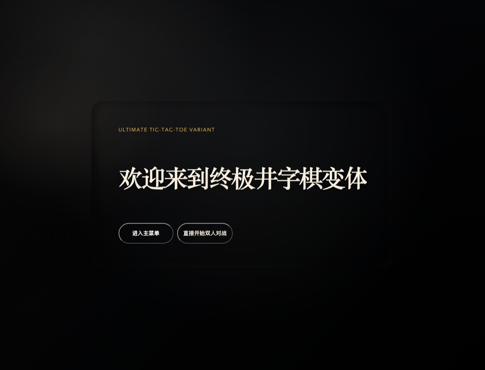
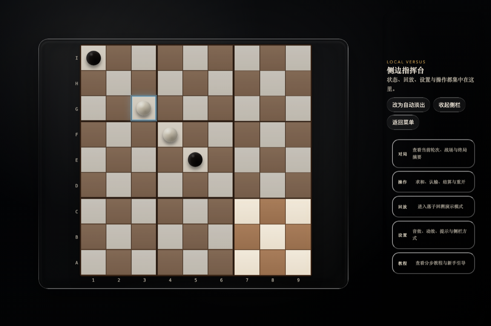
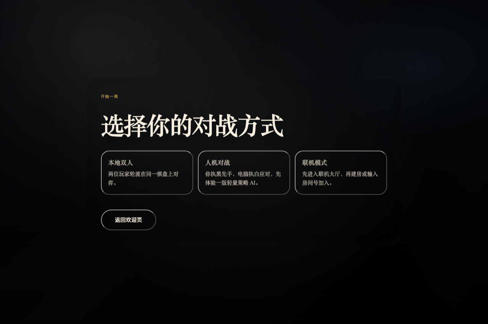

# Ultimate Tic-Tac-Toe Variant

根据 `docs/specs/Ultimate Tic-Tac-Toe Variant 规格说明书.md` 实现的 Web 版终极井字棋变体首个可运行里程碑。

> 🌐 **在线试玩（GitHub Pages）**：<https://leonchou-168.github.io/Ultimate-Tic-Tac-Toe-Variant/>

## 界面预览







## 已实现

- 本地双人对战。
- 第一手任意落子，后续按上一手位置投影到对应小棋盘。
- 目标小棋盘已占领或填满时自动进入自由落子。
- 小棋盘三连珠占领，占领后禁止继续落子。
- 按占领小棋盘数量结算胜负。
- 主动结算支持“未占领小棋盘均无法再决出胜方”的规则。
- 认输、求和请求与接受/拒绝响应。
- 上一手提示、合法小棋盘高亮、禁用区域弱化。
- 响应式拟 3D 棋盘、木质棋盘、黑白云子风格棋子。
- Vitest 核心规则测试。

## 开发命令

```bash
npm install
npm run dev
npm test
npm run build
```

## 本地运行

### 1. 环境要求

- Node.js 18 或更高版本（推荐使用最新 LTS）
- npm 9 或更高版本

可先确认版本：

```bash
node -v
npm -v
```

### 2. 安装依赖

在项目根目录执行：

```bash
npm install
```

### 3. 启动开发环境

```bash
npm run dev
```

启动后终端会输出本地访问地址，默认通常是：

```text
http://localhost:5173
```

用浏览器打开后即可开始本地双人对战。

### 3.1 全局终端运行

如果你希望在任意目录里直接用一个全局命令启动它，可以在项目根目录执行：

```bash
npm install
npm link
```

执行完成后，会注册一个全局命令：

```bash
uttv
```

默认等价于：

```bash
npm run dev
```

还支持这些子命令：

```bash
uttv dev
uttv test
uttv build
uttv help
```

如果你以后不想保留这个全局命令，可以在项目根目录执行：

```bash
npm unlink -g uttv
```

### 4. 运行测试

```bash
npm test
```

这会运行 `src/game/engine.test.ts` 中的核心规则测试，重点验证：

- 首手任意落子
- 投影落子限制
- 小棋盘占领判定
- 主动结算条件
- 认输与求和流程

### 5. 生产构建

```bash
npm run build
```

构建产物会输出到 `dist/` 目录，可用于静态部署。

如需构建 GitHub Pages 版本（仓库名为 `Ultimate-Tic-Tac-Toe-Variant`），使用：

```bash
GITHUB_PAGES=1 npm run build
```

该命令会把 base path 设为 `/Ultimate-Tic-Tac-Toe-Variant/`，产物可直接发布到 GitHub Pages。

## 联机服务器教程

当前仓库是**前端 + 纯规则引擎**里程碑，联机服务器还没有落地。如果你要继续做双人在线对战，建议按照下面这份教程推进：

- 详细教程：[`docs/联机服务器教程.md`](docs/联机服务器教程.md)
- Railway 公网部署：[`docs/Railway 联机部署指南.md`](docs/Railway%20联机部署指南.md)
- Vercel 前端部署：[`docs/Vercel 前端部署指南.md`](docs/Vercel%20前端部署指南.md)
- 文档索引：[`docs/README.md`](docs/README.md)

这份教程包含：

- 推荐的目录结构
- Socket.io 服务端初始化
- 房间匹配与加入流程
- 落子、认输、求和、主动结算的事件设计
- 如何复用 `src/game/engine.ts` 作为服务端权威规则引擎
- 本地联调与部署建议

如果你已经完成联机功能，并希望把它部署到公网，推荐直接采用：

- 前端：Vercel
- 联机后端：Railway

当前仓库已经补充了：

- `.env.example`
- `railway.json`
- `vercel.json`
- `scripts/deploy_backend.sh`
- [`docs/Railway 联机部署指南.md`](docs/Railway%20联机部署指南.md)
- [`docs/Vercel 前端部署指南.md`](docs/Vercel%20前端部署指南.md)

如果你已经买好服务器，且希望自动化部署当前联机后端，可直接使用：

```bash
scripts/deploy_backend.sh \
  --host root@your-server-ip \
  --client-origin https://your-frontend-domain.vercel.app
```

## 项目结构

```text
bin/
├── uttv.js              # 全局 CLI 入口
docs/
├── images/
│   └── sidebar-bug.png  # 调试截图保留归档
├── specs/
│   ├── Ultimate Tic-Tac-Toe Variant 规格说明书.md
│   └── Ultimate Tic-Tac-Toe Variant.md
└── 联机服务器教程.md
src/
├── App.tsx              # 游戏 UI 与交互
├── game/
│   ├── engine.ts        # 纯规则引擎
│   ├── engine.test.ts   # 核心规则测试
│   └── types.ts         # 游戏状态类型
├── main.tsx             # React 入口
└── styles.css           # 视觉与响应式样式
```

## 社区与协作

- 贡献说明：[`CONTRIBUTING.md`](CONTRIBUTING.md)
- 安全策略：[`SECURITY.md`](SECURITY.md)
- 行为准则：[`CODE_OF_CONDUCT.md`](CODE_OF_CONDUCT.md)

## 许可证

本项目采用 [MIT License](LICENSE) 发布。

许可证选择已由仓库维护者明确决定：你可以自由使用、修改和分发本项目，但需保留原始版权声明与许可声明。

## 后续里程碑建议

1. 接入真实音效与可选设置面板。
2. 增加 AI 对战难度。
3. 增加 Socket.io/WebSocket 联机房间与服务端校验。
4. 使用 Three.js / React Three Fiber 升级棋盘材质与光影。
